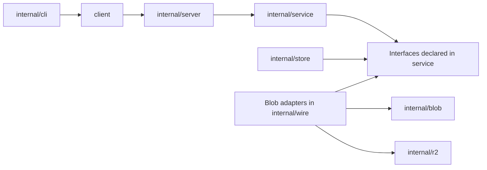

# Architecture and HTTP contracts

Vela runs one `velad` process with local SQLite metadata and one selected blob
backend. Logical paths, visibility, keys, links, and trash are metadata; immutable
contents use opaque IDs. The CLI talks to HTTP through the public Go client.

[`internal/wire`](../internal/wire/wire.go) assembles the stack for `velad` and
integration tests. [`internal/content`](../internal/content/content.go) defines
the independent streaming blob contract. Services import neither HTTP, SQL,
nor concrete storage packages; domain errors map to HTTP/API errors only in
[`internal/server/errors.go`](../internal/server/errors.go). Import rules and
exclusion of the S3 SDK from the CLI are enforced by
[`internal/archtest`](../internal/archtest/arch_test.go).

## Authorization and object lifecycle

API keys arrive only in `Authorization: Bearer`; scope ordering is `ro`, `rw`,
`admin`. Every operation checks its key prefix, including move source and target,
restore destination, trash, and links. Ancestor directory listings narrow to the
key subtree. Purge requires `admin`; listing working signed URLs requires `rw`.
Keys are administered through local `velad key` commands, never HTTP.

Public objects appear in the index and allow anonymous downloads. Unlisted
objects allow anonymous downloads but do not appear in the index; knowing the
URL grants access. Private objects require an API key or signed link. The public
side hides private, expired, trashed, and missing objects behind 404. Signed-link
failures also use 404, except an expired URL `exp`, which returns 410 before a
database lookup. The URL expiry must equal the stored expiry; editing it cannot
extend a grant. Key hashes, HMAC signatures, and upload digests use constant-time
verification.

A move updates metadata without moving blobs. Direct URLs change, but links
remain attached to object IDs. Deletion normally snapshots an object into trash;
restoration retains its object ID. Expired objects become inaccessible publicly
immediately, but authenticated API reads remain possible until janitor cleanup.
Physical content deletion follows the [storage durability rules](storage.md).

API keys and HMAC signing keys have separate lifecycles. API key creation prints
the secret once; the database stores its hash. `velad signing rotate` retires
older signing keys while preserving their links until expiry. `--revoke-all`
destroys older signing keys and revokes existing links; an already issued S3
redirect grant remains subject to its own expiry. Administrative commands live
in [`internal/velad/admin.go`](../internal/velad/admin.go).

## API surface

All paths below except `/healthz` are relative to `/api/v1`. GET routes also
accept HEAD. Routing lives in [`internal/server/api.go`](../internal/server/api.go).

| Method | Path | Contract |
| --- | --- | --- |
| GET | `/healthz` (outside API prefix) | Unauthenticated health probe |
| GET | `/info` | Version, limits, defaults, and authenticated key |
| GET | `/dirs` | Paginated explicit directory policies |
| GET / PUT / PATCH / DELETE | `/dirs/{prefix...}` | Effective view / replace / merge patch / remove rule |
| GET / POST | `/objects` | List metadata / create from inline content |
| GET / PATCH / DELETE | `/objects/{path...}` | Stat / merge patch / delete |
| GET / PUT | `/content/{path...}` | Download / streaming upload |
| POST | `/move` | Atomic logical move, optionally recursive |
| GET / DELETE | `/trash` | List / purge trash |
| DELETE | `/trash/{id}` | Purge one trash entry |
| POST | `/trash/{id}/restore` | Restore an entry |
| GET / POST | `/links` | List / create signed links |
| DELETE | `/links/{id}` | Revoke a link |

Route and header constants are in [`api/headers.go`](../api/headers.go), DTOs in
[`api/types.go`](../api/types.go), error codes in [`api/errors.go`](../api/errors.go),
and detailed endpoint semantics in [SPEC §10](SPEC.md#10-http-api-v1-контракт).
Use the [`client`](../client/client.go) package for Go integrations; it handles
retries, typed errors, and redirect credential stripping.

Canonical path validation is shared in [`api/path.go`](../api/path.go): NFC,
1024 bytes per path, 255 bytes per segment, no dot/empty segments, control
characters, or backslashes, and reserved first segments. API URL paths are
rejected rather than silently cleaned by redirects. JSON requests reject unknown
fields and enforce body limits. Free-text upload headers use percent encoding
through `api.EncodeHeaderText`; metadata mutation preconditions use revision
ETags (`"r<number>"`), while download validators use content SHA-256 ETags.

The public transport serves directory indexes, object URLs, `/s/` links,
`/_vela/assets/`, `robots.txt`, and the favicon. Directory `?format=json` returns
the same public data as the HTML [theme contract](theme.md). [Directory policies](directories.md)
control index availability, hidden entrances, and crawler hints independently
of file access; recursive moves carry their rules in the same transaction. Access decisions
remain in Go in every delivery mode.

## Transport and compatibility

Forwarded IPs and request IDs are accepted only from explicitly trusted peers.
Access logs omit queries, signatures, and credentials. Request headers have a
10-second deadline and a 128 KiB limit; request bodies have a one-minute per-read
idle deadline. There is no global upload/download duration cap. Shutdown drains
API work and allows up to 30 seconds for active requests.

API v1 preserves routes, existing field/value meanings, success statuses,
public/signed URL formats, CLI exit codes, and CLI JSON shapes. Additive optional
fields and new operations are allowed; breaking contracts require API v2.
Existing CLI commands tolerate an older API v1 server without the additive
`/dirs` endpoint: long listings omit annotations and directory URL/open commands
use the legacy `/info` behavior. Policy-capable servers keep their authorization
and disabled-index errors; absence is checked through the collection endpoint.
CLI exit statuses are defined in [`internal/cli/errors.go`](../internal/cli/errors.go);
`--json` changes representation, not success/failure. See [AGENTS.md](../AGENTS.md)
for the full compatibility and security review checklist.
